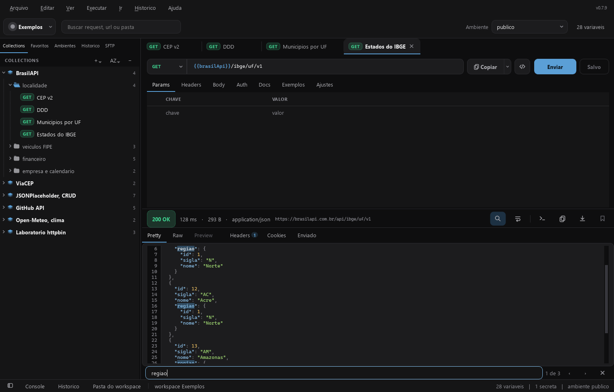
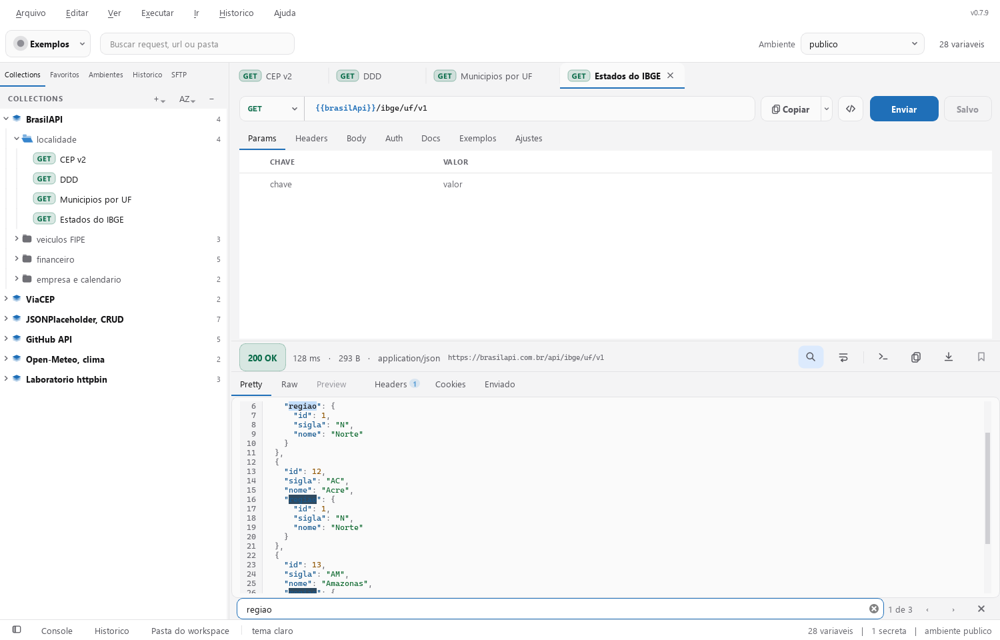

# Conduit

[](https://github.com/vinibotelho1998/Conduit/actions/workflows/release.yml)


Cliente de API de mesa, com navegador SFTP embutido, feito do zero em Python com
PySide6. Nada sai da maquina sem voce mandar: nao existe conta, nao existe nuvem e nao
existe telemetria.



<details>
<summary>Ver o tema claro</summary>



</details>

Capturas com dados de exemplo, sem executar requisições externas.

O projeto mantém os dados no seu computador, protege credenciais no cofre local e
executa HTTP e SFTP fora da thread da interface. Temas claro e escuro, busca no corpo
da resposta e atalhos de teclado ajudam a trabalhar sem interromper o fluxo.

## Instalação

Baixe o **Conduit-Setup.exe** da [última release](https://github.com/vinibotelho1998/Conduit/releases/latest),
execute e pronto. Não precisa de Python nem do repositório.

## Rodar a partir do código-fonte

Precisa de Python 3.13 ou mais novo.

```
python -m venv .venv
.venv\Scripts\pip install -r requirements.txt
.venv\Scripts\python -m conduit
```

## Testes

```
.venv\Scripts\python tests\rodar.py
```

As suítes usam servidores HTTP e SFTP locais e uma interface Qt sem tela. Cada processo
recebe um workspace temporário exclusivo, sem tocar nos seus dados. O runner mostra o
progresso e encerra uma suíte que exceda o limite de 300 segundos.

Para executar apenas uma área ou ajustar o limite:

```powershell
.venv\Scripts\python tests\rodar.py --list
.venv\Scripts\python tests\rodar.py nucleo refinamento
.venv\Scripts\python tests\rodar.py interface uso --timeout 600
```

Para desenvolver e gerar o executável, instale as ferramentas fixadas e confira a
análise estática antes dos testes:

```powershell
.venv\Scripts\python -m pip install -r requirements-dev.txt
.venv\Scripts\python -m pyflakes conduit tests packaging\launcher.py
.venv\Scripts\python -m PyInstaller packaging\Conduit.spec --noconfirm --distpath dist --workpath build
```

O instalador é compilado com o Inno Setup a partir de `packaging\Conduit_Setup.iss`.
Ao compilar manualmente, sua versão é lida do executável. Pull requests são verificados
no Windows com Python 3.13 e 3.14. O fluxo de release compila e testa antes de registrar
a versão, mantém as releases anteriores e publica um arquivo `SHA256SUMS.txt` junto ao
instalador.

## Atalhos úteis

| Atalho | Ação |
|---|---|
| Ctrl+Enter | Enviar o request aberto |
| Ctrl+S | Salvar o request |
| Ctrl+P | Procurar e abrir um request |
| Ctrl+L | Focar a URL ou o caminho na aba SFTP |
| Ctrl+G | Gerar código do request |
| Ctrl+Shift+C | Copiar como curl |
| Ctrl+F | Buscar no corpo da resposta |
| F3 / Shift+F3 | Próxima / anterior ocorrência |
| Esc, no campo de busca | Fechar a busca |

## O que ele faz

- **Collections, pastas e requests**, com arrastar, ordenar, favoritar e desfazer
- **Cinco escopos de variavel**, globais, collection, pasta, ambiente e execucao, com o
  valor efetivo no cartao do mouse e realce por cor em url, corpo e grade
- **Rascunho por aba**, como no Postman: editar nao muda o que esta gravado ate voce
  salvar, e o rascunho sobrevive ao fechamento do app
- **Exemplos de resposta** salvos dentro do proprio request, com o segredo trocado por
  `{{nome}}` antes de gravar
- **Auth** basic, bearer, api key, OAuth2 client credentials e mTLS por host, com
  heranca de collection e pasta
- **Historico** de execucao com indice, campos de rastreio e expurgo por idade
- **Importar e exportar** Postman v2.1, Insomnia v4, Bruno e OpenAPI 3, nas duas
  direcoes, mais colar curl direto na barra de url
- **Gerar codigo** em nove linguagens, e copiar como curl com Ctrl+Shift+C
- **SFTP** no mesmo workspace: navegar, baixar, enviar, criar pasta, renomear e apagar,
  com previa de arquivo de texto sem precisar baixar. A chave do servidor e conferida
  contra o `known_hosts` do workspace, e servidor novo mostra a impressao digital antes
  de voce confiar
- **Transferências protegidas**: downloads usam arquivos temporários exclusivos;
  uploads só recebem o nome final depois de concluir e confirmar o tamanho. O conteúdo
  anterior é preservado se a transferência falhar
- **Console** com a fita do que o app fez na sessao
- **Tema claro e escuro** e duas densidades, trocados na hora pelo menu Ver

## Onde ficam os dados

Fora do repositorio, em `%USERPROFILE%\Conduit`, um diretorio por workspace. Cada
request e um arquivo YAML, entao o diff do git mostra a mudanca de verdade em vez de uma
linha gigante.

Cada workspace nasce com um `.gitignore` proprio que deixa de fora segredo, historico,
cookie, certificado e rascunho. O que pode ser versionado e compartilhado e o contrato:
nome de variavel, endpoint, header e corpo.

## Segredo

Valor marcado como secreto nunca vai pro arquivo versionado. Ele fica em
`.secrets/vault.dbx`, cifrado em AES-256-GCM, com a chave protegida pela DPAPI do
Windows, entao so a sua conta de usuario nesta maquina abre. A senha do certificado
cliente, o token do OAuth2 e a credencial de cada servidor SFTP moram no mesmo lugar.

O mesmo cuidado vale pra tudo que sai do app: historico, exemplo salvo, codigo gerado e
curl copiado trocam o valor do segredo de volta por `{{nome}}` antes de gravar ou
copiar. A troca e pelo valor e nao pelo nome do header, porque nem todo segredo viaja
num header conhecido, e o basic ainda embaralha usuario e senha em base64.

O histórico também remove os valores secretos em URLs codificadas, strings JSON,
mensagens de erro e campos de rastreio. Ao girar uma credencial OAuth2, o cache do token
é invalidado. Configure o endereço final do provedor em `tokenUrl`: redirects não são
seguidos na obtenção do token, para evitar o reenvio da credencial a outro endereço.

Para substituir arquivos existentes via SFTP, o servidor precisa aceitar renomeação
atômica (`posix-rename`) e ajuste de permissões. Uploads sobre links simbólicos são
recusados para preservar o link e seu alvo. Servidores sem essa extensão aceitam uploads de
arquivos novos; uma substituição recusada preserva o arquivo anterior e mostra o motivo.
Um corte de conexão pode deixar um arquivo remoto oculto `.conduit-*.parcial`, que pode
ser removido depois de conferir que não há transferência em andamento.

## Estrutura

```
conduit/core/    modelo, motor de envio, storage, cofre, historico, formatos, sftp
conduit/gui/     janela, arvore, editor, resposta, navegador sftp, dialogos
conduit/gui/tokens.py   cor, espaco, raio e fonte. Toda a interface sai daqui
CHANGELOG.md     o que mudou em cada versao
```

## Licença

Distribuído sob a [licença MIT](LICENSE).

O que este projeto usa de terceiros está listado no [NOTICE.md](NOTICE.md).

